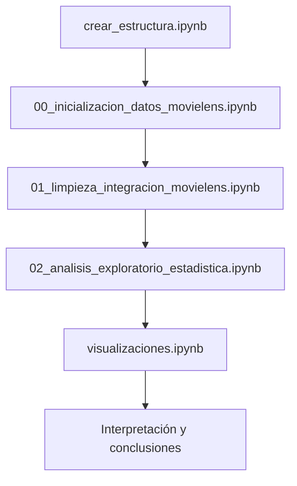

# Proyecto Integrador — DMEMCD
## Análisis descriptivo, exploratorio y estadístico de MovieLens 32M

## 1. Descripción del proyecto

El presente proyecto tiene como propósito estudiar los patrones de calificación cinematográfica registrados en **MovieLens 32M**, con el objetivo de identificar cómo se distribuyen las valoraciones de los usuarios y qué características de las películas se relacionan con sus niveles de aceptación, popularidad y variabilidad en las opiniones recibidas.

El estudio parte de una perspectiva de análisis de datos que integra procedimientos de ingeniería, preparación, exploración y análisis estadístico. No se limita a describir la distribución de las calificaciones, sino que busca examinar las relaciones existentes entre distintas dimensiones del conjunto de datos: actividad de los usuarios, volumen de evaluaciones, valoración promedio, dispersión de las calificaciones, género cinematográfico y año de estreno.

La investigación se desarrolla mediante un flujo de trabajo reproducible en Python y Jupyter Notebook. Este proceso comprende la configuración del entorno, la adquisición y validación de los datos, la caracterización de su estructura, la identificación de problemas de calidad, la limpieza y transformación de las tablas, su integración mediante identificadores comunes y, finalmente, el análisis exploratorio y la aplicación de técnicas estadísticas descriptivas e inferenciales.

Un aspecto central del proyecto consiste en distinguir entre la popularidad de una película y la valoración que recibe. El volumen de evaluaciones representa una aproximación a la participación o atención que concentra un título dentro de la plataforma, mientras que su calificación promedio refleja la tendencia central de las opiniones registradas. De manera complementaria, la dispersión de las calificaciones permite examinar el grado de heterogeneidad o convergencia entre las valoraciones de los usuarios.

Por consiguiente, el proyecto busca construir una interpretación fundamentada del comportamiento observado en MovieLens 32M, reconociendo que las asociaciones estadísticas identificadas no implican necesariamente relaciones causales ni constituyen una medida objetiva de la calidad cinematográfica.

## 2. Planteamiento de la investigación

### 2.1. Pregunta central

**¿Qué patrones caracterizan las calificaciones de las películas en MovieLens 32M y en qué medida se relacionan con el género cinematográfico, el año de estreno y la popularidad de los títulos, considerando tanto el nivel promedio de valoración como la dispersión de las opiniones de los usuarios?**

Esta pregunta articula el desarrollo del proyecto y establece las dimensiones que orientan los procedimientos de análisis.

### 2.2. Dimensiones de análisis

Para responder la pregunta central, el estudio contempla las siguientes dimensiones:

| Dimensión | Variables o elementos de interés | Propósito analítico |
|---|---|---|
| Comportamiento de las calificaciones | `rating`, `rating_mean` | Examinar la distribución y tendencia de las valoraciones. |
| Participación y popularidad | `rating_count`, `userId` | Identificar la concentración de evaluaciones y la actividad de los usuarios. |
| Dispersión de las valoraciones | `rating_std` | Analizar el grado de heterogeneidad de las opiniones recibidas por cada película. |
| Características cinematográficas | `genres`, `year` | Estudiar las diferencias de valoración asociadas al género y al año de estreno. |
| Actividad de etiquetado | `tag`, `tag_users`, `tag_application_count` | Caracterizar la actividad complementaria de los usuarios mediante etiquetas. |

### 2.3. Objetivo general

Analizar el conjunto de datos MovieLens 32M mediante técnicas de ingeniería, preparación, análisis descriptivo, exploratorio y estadístico, con el propósito de identificar patrones en las calificaciones cinematográficas y examinar su relación con la popularidad, el género y el año de estreno de las películas, considerando la dispersión de las valoraciones como una dimensión complementaria para comprender la heterogeneidad de las opiniones de los usuarios.

### 2.4. Objetivos específicos

- Configurar un entorno de trabajo reproducible y una estructura organizada para el almacenamiento, procesamiento y análisis de la información.
- Automatizar la adquisición, extracción y validación de integridad de los archivos originales.
- Caracterizar la estructura, granularidad, tipos de datos, cardinalidad y calidad de las tablas que conforman MovieLens 32M.
- Identificar posibles inconsistencias, valores ausentes, coincidencias entre atributos y problemas de integridad referencial.
- Evaluar las relaciones entre los identificadores de películas y usuarios para establecer una estructura de integración consistente.
- Normalizar los atributos multivaluados, particularmente los géneros cinematográficos, para habilitar análisis por categoría.
- Construir tablas consolidadas y métricas agregadas que preserven la granularidad de los registros originales.
- Examinar la distribución de las calificaciones, la concentración de evaluaciones y el comportamiento de los usuarios.
- Analizar las diferencias en las valoraciones promedio según el género y el año de estreno.
- Estudiar la relación entre popularidad, valoración promedio y dispersión de las calificaciones.
- Aplicar procedimientos de estadística inferencial para contrastar las diferencias y asociaciones identificadas durante el análisis exploratorio.
- Generar visualizaciones que faciliten la interpretación de los resultados y documentar los hallazgos, limitaciones y decisiones metodológicas.

## 3. Alcance y enfoque metodológico

El proyecto se desarrolla mediante un enfoque cuantitativo, observacional y no experimental, sustentado en el análisis de registros históricos de calificaciones e interacciones de usuarios.

La unidad de análisis varía de acuerdo con la pregunta abordada:

- **Calificación individual:** una observación de valoración emitida por un usuario a una película.
- **Película:** una entidad del catálogo identificada mediante `movieId`.
- **Usuario:** una entidad identificada mediante `userId`, cuya actividad puede observarse a través de las calificaciones y etiquetas.
- **Película-género:** una combinación entre una película y una de sus categorías cinematográficas.

Esta distinción es fundamental porque los resultados pueden cambiar dependiendo de la granularidad utilizada. Por ejemplo, el promedio de todas las calificaciones individuales asigna mayor peso a las películas con más evaluaciones, mientras que el promedio de los promedios por película asigna el mismo peso a cada título.

### 3.1. Estrategia de análisis

El estudio contempla tres niveles complementarios:

**A. Análisis descriptivo y exploratorio**

Se examinan las distribuciones, medidas de tendencia central, dispersión, concentración, asimetría, curtosis, valores extremos y patrones temporales. También se estudia la composición del catálogo y la representación de los géneros cinematográficos.

**B. Análisis comparativo e inferencial**

Se evalúa si las diferencias observadas en las calificaciones promedio entre géneros y entre grupos de popularidad cuentan con evidencia estadística. Se utilizan pruebas paramétricas y no paramétricas, verificaciones de supuestos y procedimientos post hoc cuando corresponda.

**C. Análisis de asociación**

Se examinan las relaciones entre volumen de evaluaciones, calificación promedio, dispersión y género cinematográfico, utilizando medidas de asociación y pruebas de independencia.

### 3.2. Criterios metodológicos

El desarrollo del análisis considera los siguientes criterios:

- La popularidad se operacionaliza mediante el número de calificaciones recibidas por cada película (`rating_count`).
- Para determinados análisis comparativos se establece un umbral mínimo de 100 evaluaciones, con el propósito de reducir la influencia de promedios sustentados en muy pocas observaciones.
- La dispersión se estudia mediante la desviación estándar de las calificaciones individuales por película (`rating_std`).
- Los géneros se tratan como una variable multietiqueta: una película puede pertenecer simultáneamente a varias categorías.
- Las diferencias estadísticamente significativas se interpretan junto con su magnitud y relevancia práctica.
- Los resultados se consideran asociaciones observacionales y no evidencias de causalidad.

El umbral de 100 evaluaciones y la definición de popularidad mediante el percentil 75 son decisiones operativas del análisis, no propiedades inherentes del conjunto de datos. Por tanto, sus resultados deben interpretarse dentro de dichos criterios.

## 4. Flujo de trabajo

El proyecto se organiza mediante una secuencia de notebooks que representan las principales etapas del procesamiento y análisis de la información.

### 4.1. Secuencia de ejecución



### 4.2. Descripción de los notebooks

| Notebook | Propósito |
|---|---|
| `crear_estructura.ipynb` | Configuración inicial y creación de la estructura de directorios del proyecto. |
| `00_inicializacion_datos_movielens.ipynb` | Localización, extracción, validación de integridad, carga y caracterización inicial de MovieLens 32M. |
| `01_limpieza_integracion_movielens.ipynb` | Evaluación de calidad, análisis de anomalías, validación de identificadores, normalización de géneros, limpieza e integración de las tablas. |
| `02_analisis_exploratorio_estadistica.ipynb` | Análisis descriptivo, exploratorio y estadístico de las características de las películas, los usuarios y las calificaciones. |
| `visualizaciones.ipynb` | Desarrollo y organización de recursos gráficos para comunicar los patrones y resultados identificados. |

**Orden de ejecución:** los notebooks deben ejecutarse siguiendo la secuencia establecida, ya que las etapas posteriores utilizan los archivos y resultados generados previamente.

## 5. Estructura del repositorio

El proyecto mantiene una organización modular que separa los datos originales, los datos procesados, el código de análisis y los resultados generados.

```text
DMEMCD/
│
├── data/
│   ├── raw/
│   │   └── ml-32m/
│   ├── processed/
│   │   └── diagnostics/
│   └── external/
│
├── models/
│
├── notebooks/
│   ├── crear_estructura.ipynb
│   ├── 00_inicializacion_datos_movielens.ipynb
│   ├── 01_limpieza_integracion_movielens.ipynb
│   ├── 02_analisis_exploratorio_estadistica.ipynb
│   └── visualizaciones.ipynb
│
├── reports/
│   ├── figures/
│   └── outputs/
│
├── src/
│
├── .gitignore
├── requirements.txt
└── README.md
```

### 5.1. Descripción de los directorios

| Directorio | Descripción |
|---|---|
| `data/raw/` | Almacena los datos originales, conservando su contenido sin modificaciones. |
| `data/raw/ml-32m/` | Contiene los archivos originales correspondientes a MovieLens 32M. |
| `data/processed/` | Almacena los conjuntos de datos derivados de los procesos de limpieza, transformación e integración. |
| `data/processed/diagnostics/` | Contiene reportes de calidad, registros con valores ausentes y resultados de validaciones. |
| `data/external/` | Reserva destinada a fuentes de información complementarias. |
| `models/` | Espacio destinado al almacenamiento de modelos estadísticos o predictivos, en caso de desarrollarse. |
| `notebooks/` | Contiene los notebooks utilizados para la adquisición, preparación, exploración y análisis de los datos. |
| `reports/` | Almacena reportes, resultados y recursos gráficos generados durante el proyecto. |
| `reports/figures/` | Destinado a las visualizaciones exportadas. |
| `reports/outputs/` | Destinado a tablas, resultados y productos analíticos. |
| `src/` | Contiene funciones y módulos reutilizables para evitar duplicación de código. |

## 6. Tecnologías y herramientas

El desarrollo del proyecto utiliza las siguientes tecnologías y bibliotecas:

| Tecnología | Aplicación |
|---|---|
| Python | Lenguaje principal de programación y procesamiento. |
| Jupyter Notebook | Entorno interactivo para documentar y ejecutar los análisis. |
| Pandas | Manipulación, transformación, limpieza e integración de datos tabulares. |
| NumPy | Operaciones numéricas y procesamiento de datos. |
| Matplotlib | Construcción de visualizaciones y gráficos estadísticos. |
| Seaborn | Visualización estadística y exploración de distribuciones. |
| SciPy | Aplicación de pruebas estadísticas e inferenciales. |
| Scikit-learn | Herramientas para procesamiento y posibles desarrollos posteriores de análisis predictivo. |

Las dependencias del proyecto se encuentran centralizadas en el archivo `requirements.txt`.

## 7. Fuente y adquisición de los datos

El proyecto utiliza el conjunto de datos **MovieLens 32M**, desarrollado por GroupLens Research, de la University of Minnesota.

**Fuente oficial:**

https://grouplens.org/datasets/movielens/

MovieLens 32M contiene información sobre películas, usuarios, calificaciones y etiquetas. La versión utilizada fue generada el 13 de octubre de 2023 y comprende:

| Característica | Cantidad |
|---|---:|
| Calificaciones | 32,000,204 |
| Aplicaciones de etiquetas | 2,000,072 |
| Películas | 87,585 |
| Usuarios | 200,948 |

El periodo de las calificaciones comprende del 9 de enero de 1995 al 12 de octubre de 2023, mientras que las aplicaciones de etiquetas abarcan del 24 de diciembre de 2005 al 12 de octubre de 2023.

### 7.1. Descarga de los datos

Los archivos originales deben obtenerse desde la fuente oficial de GroupLens y colocarse en:

```text
data/raw/ml-32m/
```

La estructura esperada del conjunto de datos es:

```text
ml-32m/
├── ratings.csv
├── tags.csv
├── movies.csv
├── links.csv
├── README.txt
└── checksums.txt
```

### 7.2. Descripción de los archivos

| Archivo | Contenido |
|---|---|
| `movies.csv` | Catálogo de películas, títulos e información de géneros. |
| `ratings.csv` | Calificaciones numéricas asignadas por los usuarios a las películas. |
| `tags.csv` | Etiquetas textuales asociadas a las películas por los usuarios. |
| `links.csv` | Correspondencias entre identificadores de MovieLens, IMDb y TMDb. |
| `README.txt` | Documentación descriptiva del conjunto de datos. |
| `checksums.txt` | Valores hash de referencia para verificar la integridad de los archivos. |

### 7.3. Consideraciones sobre los datos

- Los archivos originales no se incluyen en este repositorio debido a su tamaño.
- Los datos deben conservarse en `data/raw/ml-32m/` para mantener la compatibilidad con las rutas utilizadas en los notebooks.
- Los archivos originales deben mantenerse sin modificaciones; las transformaciones deberán almacenarse en `data/processed/`.
- La integridad de los archivos debe verificarse antes de iniciar su procesamiento.
- La descarga debe realizarse desde la fuente oficial para mantener la correspondencia con la versión utilizada durante el desarrollo.
- El uso y la redistribución de los datos deben respetar las condiciones establecidas por GroupLens.

## 8. Limpieza, normalización e integración de los datos

La preparación de los datos constituye una etapa fundamental del proyecto, puesto que la validez de los análisis posteriores depende de la correcta interpretación de la estructura y las relaciones entre las tablas originales.

### 8.1. Evaluación de calidad

Se examinaron los registros, tipos de datos, valores únicos, duplicados completos, valores ausentes y porcentajes de completitud de cada tabla.

Entre los hallazgos relevantes se identificaron:

- Títulos repetidos en `movies.title`, sin que ello implique necesariamente películas duplicadas.
- Películas del catálogo sin calificaciones registradas.
- Aplicaciones de etiquetas con valores nulos en `tags.tag`.
- Películas sin correspondencia disponible en `links.tmdbId`.
- Diferencias en la cantidad de usuarios que califican y usuarios que etiquetan.
- Diez valores distintos en la escala de calificaciones.

Se estableció como criterio no eliminar observaciones únicamente por compartir títulos, carecer de actividad o presentar identificadores externos ausentes.

### 8.2. Integridad referencial

Se utilizaron los identificadores `movieId` y `userId` para evaluar las relaciones entre las tablas.

`movieId` permite relacionar el catálogo de películas con las calificaciones, las etiquetas y los identificadores externos. Por su parte, `userId` permite comparar la actividad de los usuarios entre las tablas de calificaciones y etiquetas.

La integración se realizó respetando la granularidad de cada tabla y evitando uniones many-to-many que pudieran multiplicar artificialmente los registros.

### 8.3. Normalización de géneros

La columna `genres` contiene múltiples categorías cinematográficas separadas por el símbolo `|`. Para habilitar los análisis por género se generó una estructura normalizada denominada tabla puente película-género.

Esta transformación permite representar cada combinación `movieId`–`genre` en un registro independiente, conservando simultáneamente la columna original.

De esta manera, una película puede participar en el análisis de todos los géneros a los que pertenece, sin tratar las categorías como mutuamente excluyentes.

### 8.4. Consolidación analítica

Se construyó una tabla consolidada a nivel película que incorpora información del catálogo, identificadores externos y métricas agregadas de calificaciones y etiquetas.

Las tablas de eventos individuales se conservaron por separado para permitir análisis detallados sin alterar su granularidad.

Los principales productos de esta etapa incluyen:

- `movies_consolidated`: catálogo enriquecido con métricas por película.
- `movie_genres`: relación normalizada entre películas y géneros.
- `rating_aggregates_by_movie`: métricas de calificación por película.
- `tag_aggregates_by_movie`: métricas de etiquetado por película.
- Tablas de diagnóstico y validación de calidad.

## 9. Principales líneas de análisis estadístico

El análisis exploratorio y estadístico se orienta a responder preguntas específicas derivadas de la pregunta central.

### 9.1. Distribución de las calificaciones

Se examina la frecuencia de las puntuaciones, sus medidas de tendencia central y la forma de su distribución, con el propósito de identificar los niveles de valoración más habituales y determinar si existe una inclinación hacia puntuaciones favorables o desfavorables.

### 9.2. Composición del catálogo por género

Se analiza la frecuencia de películas asociadas a cada género, considerando su naturaleza multietiqueta. Esto permite identificar las categorías más representadas y establecer un contexto para los análisis comparativos posteriores.

### 9.3. Concentración de evaluaciones y popularidad

Se estudia la distribución del número de calificaciones recibidas por película, identificando asimetrías, concentración de actividad y títulos con volúmenes extremos de participación.

La popularidad se operacionaliza mediante el número de evaluaciones, por lo que no debe interpretarse como una medida integral de éxito comercial, reconocimiento o calidad cinematográfica.

### 9.4. Diferencias de valoración entre géneros

Se evalúa si las calificaciones promedio de las películas presentan diferencias entre géneros mediante ANOVA, Kruskal-Wallis y comparaciones post hoc de Tukey, complementando los resultados con medidas de tamaño del efecto y revisión de los supuestos estadísticos.

### 9.5. Popularidad y calificación promedio

Se comparan películas populares y no populares para determinar si existen diferencias en sus valoraciones promedio.

Se emplean pruebas como Mann-Whitney U y Welch, acompañadas de medidas descriptivas y tamaños del efecto.

### 9.6. Popularidad y género cinematográfico

Se examina si la presencia de determinados géneros se encuentra asociada con la clasificación de popularidad mediante pruebas de independencia Chi-cuadrado y correcciones por comparaciones múltiples.

### 9.7. Dispersión y estabilidad de las valoraciones

Se analiza la desviación estándar de las calificaciones para identificar el grado de heterogeneidad de las opiniones recibidas por cada película.

También se estudia su relación con el número de evaluaciones y con la calificación promedio, con el propósito de distinguir entre películas que concentran opiniones relativamente homogéneas y aquellas que presentan mayor diversidad de valoraciones.

La desviación estándar se interpreta como una medida de dispersión, no como una medida directa de incertidumbre del promedio.

### 9.8. Año de estreno y valoración

Se examina la relación entre el año de estreno y las calificaciones promedio, considerando la cantidad de películas y evaluaciones disponibles en cada periodo.

Este análisis requiere distinguir entre el promedio simple de las películas y el promedio ponderado por el volumen de calificaciones, ya que ambos representan perspectivas diferentes.

## 10. Reproducibilidad y organización del trabajo

El proyecto busca mantener un flujo de trabajo reproducible mediante las siguientes prácticas:

- **Estructura centralizada:** los datos, notebooks, módulos y resultados se almacenan en directorios específicos.
- **Automatización:** las operaciones de configuración, adquisición, validación y preparación se ejecutan mediante código.
- **Separación de datos:** se conservan los archivos originales y se almacenan por separado los resultados del procesamiento.
- **Control de dependencias:** las bibliotecas necesarias se documentan en `requirements.txt`.
- **Documentación técnica:** cada notebook incorpora explicaciones sobre los procedimientos, conceptos y decisiones metodológicas.
- **Validación de resultados:** se incorporan verificaciones para comprobar la consistencia de las transformaciones y las integraciones.
- **Ejecución secuencial:** se mantiene un orden de trabajo que permite reproducir las diferentes etapas del proyecto.

Para obtener resultados consistentes, se recomienda ejecutar los notebooks desde el entorno configurado y respetar la secuencia establecida en el flujo de trabajo.

## 11. Conclusión general

El análisis de MovieLens 32M permitió identificar que las calificaciones cinematográficas presentan patrones diferenciados en función de la participación de los usuarios, las características del catálogo y las categorías de las películas.

En primer lugar, se observó que la actividad de evaluación se encuentra concentrada en un subconjunto de títulos, mientras que la distribución general de las calificaciones presenta una tendencia favorable. La puntuación de 4.0 destaca como la más frecuente, y la media de las calificaciones individuales se sitúa por encima del punto medio de la escala.

En segundo lugar, los resultados estadísticos muestran que existen diferencias en las calificaciones promedio entre géneros cinematográficos. Aunque estas diferencias son estadísticamente identificables, la magnitud del efecto indica que el género explica únicamente una parte limitada de la variabilidad observada. Esto evidencia que las valoraciones responden a un conjunto de factores y no exclusivamente a la categoría cinematográfica de cada película.

En tercer lugar, la popularidad presenta una asociación positiva con la calificación promedio. Las películas con mayor volumen de evaluaciones tienden a registrar valoraciones superiores a las de los títulos menos populares, aunque la intensidad de la asociación es limitada. Asimismo, se identificaron diferencias estadísticamente significativas entre ambos grupos, lo que respalda la existencia de patrones distintos de valoración según el nivel de participación recibido.

De manera complementaria, el análisis de dispersión permitió observar que las películas con promedios más altos tienden a presentar menor variabilidad en sus calificaciones, particularmente cuando cuentan con un número suficiente de evaluaciones. Este comportamiento sugiere una mayor convergencia de opiniones en determinados títulos, aunque no debe interpretarse como evidencia directa de calidad objetiva o certeza absoluta de la valoración.

Por otra parte, la relación entre género y popularidad mostró que la distribución de las películas populares no es homogénea entre las categorías cinematográficas. Esto permite reconocer que ciertos géneros presentan perfiles de popularidad diferenciados dentro de la plataforma.

En términos metodológicos, el proyecto demuestra la importancia de construir una estructura de datos consistente antes de desarrollar procedimientos estadísticos. La caracterización inicial, la validación de identificadores, la conservación de registros, la normalización de géneros y la integración controlada de las tablas constituyeron condiciones necesarias para obtener resultados interpretables y reproducibles.

En consecuencia, el estudio permite responder la pregunta central al mostrar que las calificaciones de las películas no se comportan de manera uniforme y que su distribución se relaciona con diferentes dimensiones de la actividad registrada en MovieLens 32M. No obstante, las relaciones identificadas son de naturaleza observacional y no permiten establecer causalidad ni generalizar automáticamente los resultados a otras plataformas o poblaciones.

El principal resultado del proyecto es, por tanto, la construcción de un proceso integral de análisis de datos que transforma registros originales en información estructurada y evidencia estadística, proporcionando una base metodológica para investigaciones posteriores sobre comportamiento de usuarios, sistemas de recomendación y análisis de preferencias cinematográficas.

## 12. Autores

Proyecto desarrollado por:

- Jorge Emilio Suárez Rivera
- Oscar David Flores Alonso
- Iris Guadalupe Arredondo Martínez
- Santiago Valdés Arce

## 13. Referencias

Harper, F. M., & Konstan, J. A. (2015). The MovieLens Datasets: History and Context. *ACM Transactions on Interactive Intelligent Systems, 5*(4), 19:1–19:19.

https://doi.org/10.1145/2827872

**Fuente de los datos:**

GroupLens Research. *MovieLens 32M Dataset*. University of Minnesota.

https://grouplens.org/datasets/movielens/

---

*Proyecto Integrador — DMEMCD.*